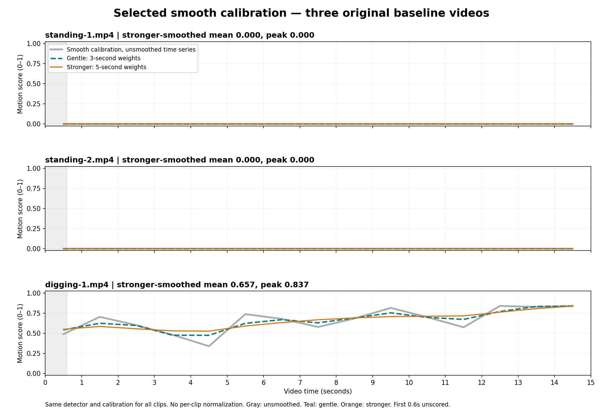
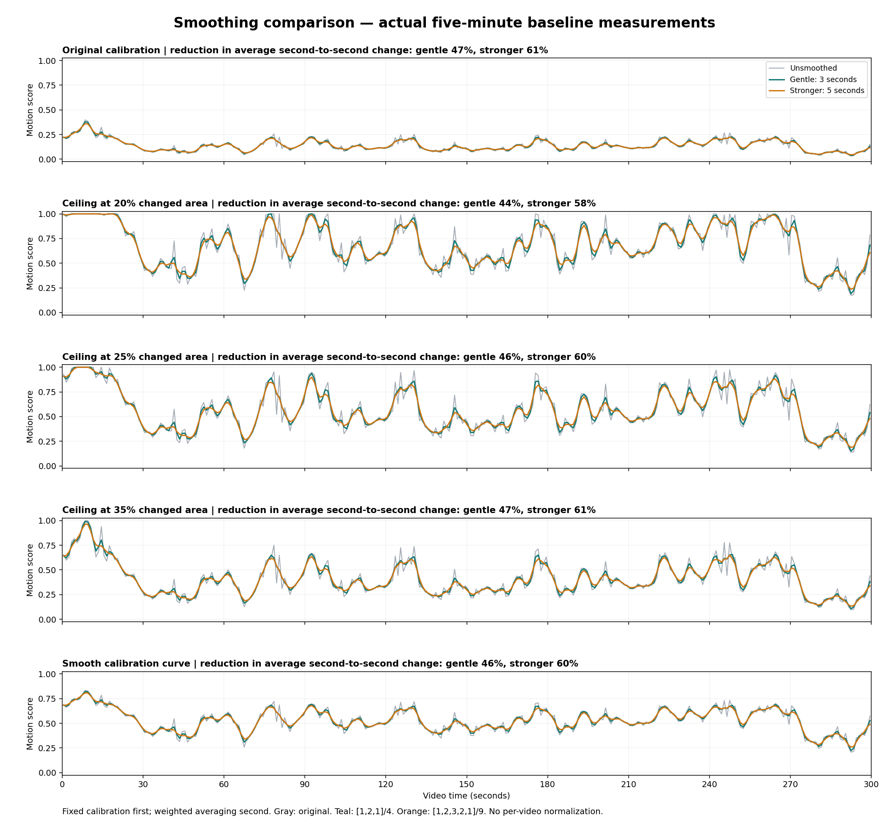
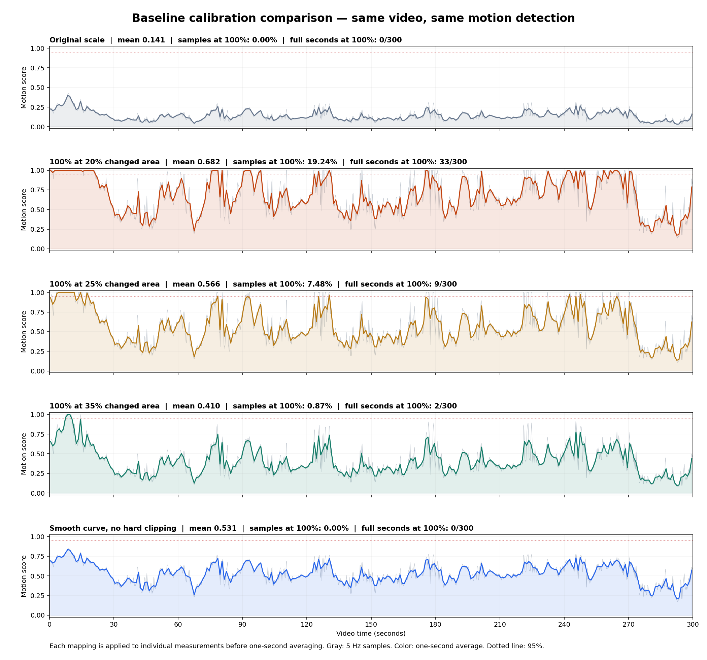

# Construction video motion graph

This experiment turns silent video from cameras mounted on construction vehicles and tools into a motion score over time. Its purpose is to help viewers find active periods in long recordings, using a lightweight mathematical calculation on CPU.

The first implementation uses Python, NumPy, and OpenCV. It requires no trained model or GPU. The score measures filtered visual change; camera movement, attachment movement, and moving shadows can all contribute.

## View the five-minute experiment


- **[Open the PNG plot](results/5min-motion.png)** to view the graph directly on GitHub.
- **[Open the HTML file](results/5min-motion.html)**, download the raw file, and open it in a browser. It contains the same Matplotlib plot as an embedded SVG and works offline. GitHub displays HTML source rather than running it as a webpage.
- **[Source recording](5min.mp4)** used for the experiment.

The horizontal axis covers **0–300 seconds**. Orange is the average score for each second; the faint gray line shows the underlying measurements, sampled five times per second. These are the actual results, without five-second aggregation or per-video min/max normalization.

The source recording lasts approximately 305 seconds; this plot shows the requested first 300 seconds.

| Measurement, first 300 seconds | Result |
| --- | ---: |
| Average motion score | 0.140984 |
| Highest one-second average | 0.397896 |
| Interval with the highest one-second average | 8–9 seconds |
| Highest individual comparison score | 0.424440 |
| Valid frame comparisons | 1,497 |

## Selected smooth calibration on the original 15-second videos

The lowest panel in the five-minute comparison uses the **smooth calibration curve**. We applied those same fixed parameters to fresh runs of `standing-1.mp4`, `standing-2.mp4`, and `digging-1.mp4`.



- **[View the three-video plot](results/15sec-smooth-baselines.png)** directly on GitHub.
- **[Download the HTML review](results/15sec-smooth-baselines.html)** and open it in a browser. It includes the plot, summary table, and a button to download the complete JSON with original measurements, calibrated samples, and smoothed per-second scores.

The calibration is `1.15 * s / (s + 0.15)`, where `s = clip((A - 0.01) / 0.99, 0, 1)` and `A` is filtered changed-area fraction. All original detector parameters remain fixed. Calibration is applied to each comparison before one-second averaging.

Three curves are shown for every video: unsmoothed, gentle `[1,2,1]/4`, and stronger `[1,2,3,2,1]/9`. There is no separate tuning or normalization for each clip.

| Video | Calibrated mean over comparisons | Gentle peak second | Stronger minimum second | Stronger peak second |
| --- | ---: | ---: | ---: | ---: |
| Standing 1 | 0.0000 | 0.0000 | 0.0000 | 0.0000 |
| Standing 2 | 0.0000 | 0.0000 | 0.0000 | 0.0000 |
| Digging 1 | 0.6659 | 0.8369 | 0.5253 | 0.8373 |

The three standing curves overlap exactly at zero. The initial 0.6 seconds is unscored; the first bucket has two valid comparisons. These standalone clips have no neighboring context, so temporal smoothing repeats the edge score at each true clip boundary. In the longer five-minute experiment, actual future footage supplies the context beyond the displayed 300-second boundary.

Means over individual comparisons and means over displayed seconds differ slightly because the first second contains fewer comparisons. The JSON and HTML distinguish those statistics explicitly. The original 15-second detection outputs reproduced the previous calibration experiment.

## Smoothing comparison

After calibrating the one-second scores, we tested two weighted averages to reduce rapid fluctuations while preserving the raw data:

| Version | Weights across consecutive seconds | Look-ahead |
| --- | --- | ---: |
| Unsmoothed | Current score | 0 seconds |
| Gentle | `[1, 2, 1] / 4` | 1 second |
| Stronger | `[1, 2, 3, 2, 1] / 9` | 2 seconds |

- **[View the smoothing comparison plot](results/5min-smoothing-comparison.png)** on GitHub.
- **[Download the interactive smoothing HTML](results/5min-smoothing-comparison.html)** and open it in a browser. Select any of the five calibration mappings and toggle the unsmoothed, gentle, and stronger curves. The page also downloads the complete comparison results as JSON.



For the 35% calibration candidate:

| Version | Average one-second score | Peak one-second score | Reduction in average absolute second-to-second change |
| --- | ---: | ---: | ---: |
| Unsmoothed | 0.4100 | 1.0000 | 0% |
| Gentle | 0.4100 | 0.9902 | 47.2% |
| Stronger | 0.4099 | 0.9645 | 60.9% |

Here, averages weight each displayed one-second bucket equally. Earlier whole-clip statistics weight individual comparisons equally, so they differ slightly because the first bucket has only two valid comparisons.

The smoothing stage operates after calibration. It does not modify detection, normalize each recording, or replace raw measurements. Gentle smoothing is the first candidate to review; stronger smoothing softens brief peaks more.

The plot uses actual seconds 300 and 301 as future context rather than extrapolating the end of the displayed 0–300s interval. At the recording start, the first available value is repeated as left context. The first bucket still uses only its valid samples; the initial 0.6s is unscored.

Reusable implementation: [smoothing.py](smoothing.py).

```python
from smoothing import smooth_scores, GENTLE, STRONGER

gentle = smooth_scores(one_second_scores, GENTLE)
stronger = smooth_scores(one_second_scores, STRONGER)
```

Supply neighboring scores when processing chunks, then trim the context. The helper preserves `None`/`NaN` gaps and smooths each continuous run independently, without bridging unavailable footage. Repeating edge values is appropriate only at true run boundaries, not at every upload boundary.

Checks cover constant and zero inputs, gap preservation, 0–1 bounds, input preservation, the exact three-point impulse response, chunk equivalence with context, agreement with the original measurements, and JavaScript syntax. These are presentation experiments; the detector defaults remain unchanged.

## Calibration comparison on the baseline videos

The original graph underuses the 0–1 scale. This experiment keeps detection and the noise floor unchanged, then compares fixed score mappings on the first 300 seconds of `5min.mp4`. All four recordings in this folder are our calibration baselines.



- **[View the comparison PNG](results/5min-calibration-comparison.png)** directly on GitHub.
- **[Download the interactive HTML](results/5min-calibration-comparison.html)** and open it locally. Its slider changes the image-area threshold mapped to 100%, redraws the graph, and reports saturation. It is self-contained and uses the actual per-comparison measurements.

| Mapping | Mean score | Comparisons at 100% | Full seconds at 100% | Seconds with mean ≥95% |
| --- | ---: | ---: | ---: | ---: |
| Original | 0.141 | 0% | 0 / 300 | 0 |
| Ceiling at 20% changed area | 0.682 | 19.24% | 33 / 300 | 53 |
| Ceiling at 25% changed area | 0.566 | 7.48% | 9 / 300 | 15 |
| Ceiling at 35% changed area | 0.410 | 0.87% | 2 / 300 | 3 |
| Smooth curve | 0.531 | 0% | 0 / 300 | 0 |

“Full seconds at 100%” means every valid measurement in that second saturates. A partially saturated second can still average below 100%. Gray lines show individual comparisons and colored lines show one-second means; the red dotted line marks 95%.

For filtered changed area `A` and a fixed ceiling `C`, the candidate score is:

```python
score = clip((A - 0.01) / (C - 0.01), 0, 1)
```

The smooth alternative starts with the original score `s`:

```python
score = 1.15 * s / (s + 0.15)
```

The smooth curve reaches 1 only at `s = 1`; it has no hard plateau on this baseline and peaks at a one-second average of 0.835. The 35% ceiling reaches 1 in two seconds, while preserving more headroom than the 20% and 25% candidates. Neither is selected as the new default yet.

Mappings are applied **before** one-second averaging. Their constants do not depend on the input video's extrema, duration, or average. The recording is processed once with the original detector; mappings reuse the same measured changed areas. The detector was rerun for this experiment, and its original five-minute mean reproduced 0.140984.

Both standing recordings remain zero for every candidate. The 15-second digging clip has mean scores of 0.246 originally, 0.859 at a 20% ceiling, 0.801 at 25%, 0.674 at 35%, and 0.666 with the smooth curve. These are calibration results on our baselines; the original plots and algorithm definition below remain available for comparison.

## How the calculation works

Every measurement uses the same configuration:

1. Resize the frame to **320 pixels wide**, preserving its aspect ratio; smaller inputs are not enlarged.
2. Convert to grayscale and apply a **5 × 5 Gaussian blur** to reduce fine image noise.
3. Sample at **5 frames per second** and compare frames **0.6 seconds apart**.
4. Subtract the median signed brightness difference to suppress approximately uniform additive exposure changes.
5. Keep pixels with an absolute corrected brightness difference **greater than 12 out of 255**.
6. Apply a **3 × 3 morphological opening** and discard connected changed regions smaller than **0.1% of the analyzed image**.
7. Calculate the retained changed-area fraction, `A`.
8. Apply a fixed **1% image-area noise allowance**:

```python
score = max(0.0, min(1.0, (A - 0.01) / 0.99))
```

A one-second result is the mean of valid comparisons in that second. A whole-clip result is the mean of all valid comparisons, so partial seconds receive the appropriate weight.

### What the values mean

- **0** means no change survived the filters and fixed noise allowance. It does not mean the original frames are identical.
- Values between **0 and 1** represent increasing image area with qualifying visual changes.
- **1** is the upper bound of the fixed scale, not the largest value observed in a particular recording.

For example, a score near 0.25 corresponds to approximately a quarter of the analyzed image showing qualifying change, adjusted for the noise allowance. It is not a productivity percentage, a movement probability, or a physical speed measurement.

Parameters remain fixed across recordings. There is no adjustment based on each video's minimum, maximum, or average. Changing the parameters changes the measurement definition and should produce a new algorithm/configuration version.

## Initial 15-second checks

All three initial recordings are 640 × 480 at 25 fps. They used the same settings as the five-minute experiment.

| Recording | Whole-clip score | Highest one-second average | Mean retained changed area before the final noise allowance |
| --- | ---: | ---: | ---: |
| [digging-1.mp4](digging-1.mp4) | 0.245730 | 0.408996 | 25.327293% |
| [standing-1.mp4](standing-1.mp4) | 0.000000 | 0.000000 | 0.000000% |
| [standing-2.mp4](standing-2.mp4) | 0.000000 | 0.000000 | 0.019495% |

Both standing clips contain image differences. Filtering removes the small changes in `standing-1`; `standing-2` retains a tiny changed area, but every comparison stays below the fixed 1% allowance. Their zero scores are therefore intentional consequences of the filtering.

These clips are development examples, not an independent evaluation set.

## Different recording lengths and chunk boundaries

The per-comparison calculation is independent of the total recording length. A 15-second input and a 60-second input use the same time interval and thresholds.

For the website timeline, retain **one score per second** rather than replacing each arbitrarily sized upload with one number. A whole-upload average can dilute brief activity differently depending on upload length.

Each comparison needs 0.6 seconds of preceding footage:

- Without preceding context, the initial **0.6 seconds is unmeasured**, not zero.
- In these experiments, the first second contains two valid comparisons; later complete seconds contain five.
- For continuous chunk processing, prepend 0.6 seconds from the previous recording, exclude that context from the output period, and preserve the shared 5 Hz sampling grid.
- Do not compare across a genuine recording gap. Mark unavailable coverage explicitly.

A separate engineering check compared a constructed 60-second recording against four 15-second jobs with preceding context. Their per-comparison scores matched exactly. The fixture repeated existing footage and is not additional real-world validation.

## Limitations to test next

This baseline deliberately trades sensitivity to tiny changes for a quieter graph. Small or slow genuine movement can be suppressed along with noise.

- Strong engine vibration or camera shake may produce false activity.
- Large areas of wind-blown vegetation, changing shadows, rain, or dust may contribute.
- Low-contrast movement can be missed; grayscale also loses color-only differences.
- Median brightness correction can suppress broad, approximately uniform changes.
- Equal physical actions can score differently under different viewpoints and textures.
- Identical images alone cannot distinguish a frozen recording from a perfectly still scene.
- The calculation does not identify digging, loading, idling, or productive work.

Evaluate more parked-but-vibrating, windy, travelling, nighttime, and slow-action footage before adding stabilization, region masks, or optical flow. Add complexity in response to measured failures.

## Files and implementation status

```text
contech-motion/
├── README.md
├── smoothing.py
├── 5min.mp4
├── digging-1.mp4
├── standing-1.mp4
├── standing-2.mp4
└── results/
    ├── 5min-motion.png
    ├── 5min-motion.html
    ├── 5min-calibration-comparison.png
    ├── 5min-calibration-comparison.html
    ├── 5min-smoothing-comparison.png
    ├── 5min-smoothing-comparison.html
    ├── 15sec-smooth-baselines.png
    └── 15sec-smooth-baselines.html
```

The files currently committed here are input recordings, plot exports, and a reusable NumPy smoothing helper. The Python analysis and plotting code was run during the experiment; it is not yet packaged as a runnable application in this folder. There is no deployed Lambda service in this repository.

The analysis used NumPy and OpenCV; plot generation used Matplotlib. Processing the approximately five-minute source took **6.76 seconds in the development environment**, including decoding. This excludes download time and is not an AWS Lambda benchmark or cost estimate.
