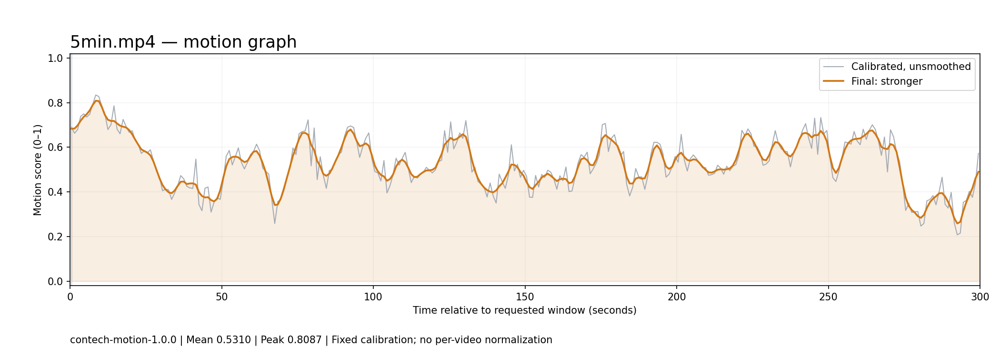

# Construction video motion graph

A runnable CPU pipeline for motion timelines from silent construction-equipment POV video. It produces one score per second, a clip summary, coverage information, and optional PNG/HTML exports.

**Final configuration:** the selected smooth calibration curve, followed by stronger five-second temporal smoothing. This is the lowest panel from the reviewed five-minute comparison, with the stronger smoothing line selected. The raw detector and calibration values remain available in the JSON.

## Quick start

Use **Python 3.12** for the tested environment. Run these commands from `contech-motion`:

```bash
python -m venv .venv
source .venv/bin/activate
pip install -r requirements.txt

python motion_graph.py digging-1.mp4 --output digging-result.json
```

Analysis requires only **NumPy and headless OpenCV**. OpenCV supplies the video decoder; the core does not invoke a separate FFmpeg executable. No model download or GPU is required.

To create images and a self-contained HTML report, install the optional Matplotlib dependency:

```bash
pip install -r requirements-plot.txt

python motion_graph.py 5min.mp4 \
  --end-seconds 300 \
  --output 5min-result.json \
  --plot 5min-plot.png \
  --html 5min-plot.html
```

Open the PNG directly, or download the HTML and open it in a browser. The HTML contains the plot and a button to download its embedded results JSON. It works offline. GitHub shows HTML source rather than executing it as a website.

## Final baseline results

Fresh output from the final script:

| Input | Requested window | Mean final one-second score | Peak final one-second score |
| --- | --- | ---: | ---: |
| [standing-1.mp4](standing-1.mp4) | Entire 15s | 0.000000 | 0.000000 |
| [standing-2.mp4](standing-2.mp4) | Entire 15s | 0.000000 | 0.000000 |
| [digging-1.mp4](digging-1.mp4) | Entire 15s | 0.657294 | 0.837259 |
| [5min.mp4](5min.mp4) | First 300s | 0.530966 | 0.808654 |

- **[Final five-minute plot](results/final/5min.png)** and **[HTML report](results/final/5min.html)**.
- Actual JSON outputs: [Standing 1](results/final/standing-1.json), [Standing 2](results/final/standing-2.json), [Digging 1](results/final/digging-1.json), [five-minute window](results/final/5min.json).
- Reviewed three-video comparison: **[PNG](results/15sec-smooth-baselines.png)** / **[HTML](results/15sec-smooth-baselines.html)**. Those plots include both temporal smoothing options for comparison.



The long source is approximately 305 seconds. The final 0–300s result uses real footage after second 300 as smoothing context. The short standalone clips use repeated edge values where neighboring footage is unavailable.

## Python API

Run from this directory, or add this directory to your application's module search path:

```python
from motion_graph import Config, analyze_video

result = analyze_video("digging-1.mp4")

clip_summary = result["score"]
timeline_scores = result["scores"]
coverage_and_raw_values = result["seconds"]

# Optional review modes; default is "stronger".
gentle = analyze_video("digging-1.mp4", Config(smoothing="gentle"))
unsmoothed = analyze_video("digging-1.mp4", Config(smoothing="none"))
```

`analyze_video` raises `ValueError` for unsupported or invalid media/timing and invalid requests. The CLI prints errors to stderr and exits with status 1; successful JSON is written to the requested file or stdout. Export errors also exit nonzero. Do not interpret a failed job as a zero-motion result.

## Input contract

The input is a **local, completed, independently decodable video file**. Download an S3 object to temporary storage before calling the script. Keep object identity, camera identity, and capture timestamps in your orchestration layer.

- Tested real recordings: H.264, 640 × 480, 25 fps; approximately 15s and 305s.
- Intended ingestion jobs: completed 15–60s chunks. The five-minute recording is a calibration and regression baseline.
- Source must report a valid frame rate of at least 5 fps and monotonic decoded timestamps.
- Frame selection uses decoded timestamps; malformed clocks and timestamp gaps larger than the sampling interval fail explicitly. Variable-frame-rate and other codec/camera combinations need integration checks before adoption.
- Dimensions must remain stable. Validate recordings upstream; this is not a full media-integrity validator. When EOF is reached, a mismatch between decoded and declared frame count is rejected.
- There is no audio processing, live-stream ingestion, camera timestamp OCR, person detection, or action classification in this task.

Window options refer to seconds relative to the **first decoded frame in the input file**. Explicit `--start-seconds` and `--end-seconds` must be whole seconds, with end greater than start. Without an explicit end, the actual final partial second is retained. Bounds beyond the recording fail rather than inventing coverage.

## Output contract

`schema_version` **`1.0`**; algorithm version **`contech-motion-1.0.0`**. The full output includes the numerical configuration. Keep both versions and the configuration with persisted results.

| Field | Meaning |
| --- | --- |
| `source` | Filename, SHA-256 of the complete input, source dimensions, decoder clock origin, and decoding metadata |
| `config` | Detection/calibration settings, smoothing mode, and smoothing weights |
| `window` | Input-relative start/end, output duration, and unscored prefix |
| `scores` | Final score for each one-second output bucket, in order; `null` means unavailable |
| `seconds` | Detailed final/raw scores, timing, sample counts, and coverage for each bucket |
| `score` | Arithmetic mean of available **final one-second scores**, useful as a clip summary |
| `peak_score` | Maximum final one-second score |
| `calibrated_sample_mean` | Mean calibrated score across individual valid comparisons, before temporal smoothing |
| `sample_count` | Number of valid comparisons inside the requested window; excludes context |
| `elapsed_seconds` | Local analysis duration, including decoding and checksum; excludes orchestration and plotting |
| `samples` | Optional comparison-level diagnostics when `--include-samples` is supplied |

Each `seconds` entry contains:

- `start_seconds`, `end_seconds`: half-open interval `[start, end)`, relative to the requested output window. The last bucket may be shorter than one second.
- `input_start_seconds`: bucket start relative to the input file.
- `score`: final temporally smoothed score used for the viewer graph.
- `calibrated_score`: smooth-calibrated one-second average **before temporal smoothing**.
- `detector_score`: one-second average of the original filtered-area score.
- `changed_area_fraction`: one-second average retained changed area before the detector's area deadband.
- `sample_count`, `expected_sample_count`, `coverage_fraction`: valid and expected sample counts, and their ratio. This is sampling coverage, not model confidence.
- `smoothing_edge_padded`: whether missing neighboring bucket context was replaced with the nearest valid edge value.

A mean over comparisons can differ from a mean over seconds because a partially measured second contains fewer comparisons. For the standalone digging clip, `calibrated_sample_mean` is 0.665918 while the final smoothed `score` is 0.657294. Do not mix these statistics.

### Mapping to the website clock

If the first decoded frame has upstream UTC time `T`, the absolute time of a bucket is:

```text
T + window.input_start_seconds + seconds[i].start_seconds
```

The AI code does not establish camera clock accuracy. The backend supplies that mapping and keeps different camera clocks aligned.

When joining chunk outputs, join timestamped buckets rather than averaging arbitrarily sized upload summaries. Use the same configuration and a shared one-second/5 Hz sampling grid for every chunk.

## Final algorithm and fixed parameters

1. Resize to width 320, preserving aspect ratio and avoiding upscaling.
2. Convert to grayscale and apply 5 × 5 Gaussian blur.
3. Sample at 5 Hz; compare frames three samples apart (nominally 0.6s).
4. Subtract the median signed brightness difference to reduce approximately uniform additive exposure changes.
5. Threshold absolute corrected changes at greater than 12 brightness levels out of 255.
6. Apply 3 × 3 morphological opening; discard connected changed regions below 0.1% of the analyzed image.
7. Let `A` be the retained changed-area fraction. Compute the original detector score:

```python
s = clip((A - 0.01) / 0.99, 0, 1)
```

8. Apply the selected smooth calibration to **each comparison**:

```python
calibrated = 1.15 * s / (s + 0.15)
```

9. Average valid calibrated comparisons within each one-second bucket.
10. Apply the default centered five-second temporal kernel:

```python
final[t] = (
    calibrated_seconds[t - 2]
    + 2 * calibrated_seconds[t - 1]
    + 3 * calibrated_seconds[t]
    + 2 * calibrated_seconds[t + 1]
    + calibrated_seconds[t + 2]
) / 9
```

The optional gentle kernel is `[1, 2, 1] / 4`; `none` omits temporal smoothing. There is no per-video minimum/maximum normalization or filename-specific behavior. Default constants apply equally to every recording. Custom Python `Config` values are persisted in the output; a changed configuration defines a different measurement scale and should be versioned by your pipeline.

The original 1% area noise allowance explains why the standing clips reach exactly zero: small image differences exist, but do not survive the combined filters and allowance. A final score of 1 is an upper bound, not a target every recording must reach. The smooth calibration avoids hard clipping below the original detector's ceiling.

## Chunk context: important for backend integration

Detection needs 0.6s of preceding footage. Default temporal smoothing additionally needs two neighboring one-second buckets on each side. Supplying only 0.6s of prefix fixes detection continuity but is insufficient for the final smoothed graph.

For a **60-second target chunk**, supply **3 seconds of preceding video and 2 seconds of following video**, on the same sampling clock. This creates a 65-second input:

```text
Input:  [3s preceding context][60s target][2s following context]
Output:                       [60s target]
```

```bash
python motion_graph.py chunk-with-context.mp4 \
  --start-seconds 3 --end-seconds 63 \
  --output target-motion.json
```

The script retains available context for calculation, then returns only the requested 60 seconds. Bucket times start at zero in the output, and `window.input_start_seconds` remains 3. Explicit requested windows automatically decode up to two seconds beyond their end for the default smoothing when footage is available.

For the first or last recording of a continuous run, available edge values are repeated for smoothing. These buckets are marked `smoothing_edge_padded`. Without prior video, the initial 0.6s remains unmeasured; the first bucket contains two comparisons rather than five. It is not filled with zero-motion measurements.

The reusable [smoothing.py](smoothing.py) helper preserves `None`/`NaN` gaps and processes continuous runs independently. The video analyzer rejects large timestamp discontinuities; orchestration should split recordings at actual gaps. Never prepend context from across an outage. Do not reset smoothing at every upload boundary.

## Command reference

```text
python motion_graph.py VIDEO
  --output PATH          JSON file; omit to print JSON to stdout
  --plot PATH            Optional PNG plot; requires requirements-plot.txt
  --html PATH            Optional offline HTML with embedded results JSON
  --smoothing MODE       stronger (default), gentle, or none
  --start-seconds N      Whole-second output start in the input; default 0
  --end-seconds N        Whole-second output end; default actual input end
  --include-samples      Include comparison timestamps and diagnostic values
```

The CLI refuses output paths that would overwrite the input recording or collide with another output format. It creates missing output directories. Passing an output path replaces that result file; use unique job paths in orchestration.

## Validation and reproducibility

```bash
pip install -r requirements-dev.txt
python -m pytest -q
```

Checks cover the original four real baseline recordings, exact agreement with reviewed final values, chunk processing with context in all smoothing modes, noise suppression, local motion, partial coverage, invalid inputs/windows, unsupported low frame rates, short recordings, smoothing gaps, CLI JSON/PNG/HTML exports, and protection against overwriting an input.

Comparison history is preserved:

- Original detector: [PNG](results/5min-motion.png), [HTML](results/5min-motion.html).
- Calibration candidates: [PNG](results/5min-calibration-comparison.png), [HTML](results/5min-calibration-comparison.html).
- Smoothing candidates: [PNG](results/5min-smoothing-comparison.png), [HTML](results/5min-smoothing-comparison.html).
- Selected calibration on all short baselines: [PNG](results/15sec-smooth-baselines.png), [HTML](results/15sec-smooth-baselines.html).

These recordings are calibration baselines. They establish repeatability of the chosen behavior, not accuracy on every construction site or camera installation.

## Handoff responsibilities and limits

**AI deliverable:** fixed CPU algorithm, calibrated and smoothed outputs, coverage/provenance, reproducible baseline results, plotting exports, and tests.

**Backend/data integration:** download and validate completed recordings; supply chronological context; attach project/camera/capture-time metadata; handle retries and failures; store JSON and publish timestamped scores to the website. The inputs and outputs are ordinary local files/Python dictionaries. No AWS credentials or network access are required by the analysis itself.

**Frontend:** draw `seconds[].score` on the source timeline, show unavailable coverage distinctly, and preserve the raw values for debugging. Use coverage and edge flags when presenting a recording boundary.

For Lambda, package the pinned analysis dependencies for the chosen runtime/architecture, download to temporary storage, call `analyze_video`, and persist results to S3 or your backend. A bare return value from an asynchronously S3-triggered Lambda is not result delivery. AWS packaging, IAM, orchestration, deployment, and an AWS throughput/cost benchmark remain integration work for the platform team.

This measures visual change, not construction productivity or a named action. Travel, rotation, shadows, wind, rain, dust, and vibration may contribute. Small or slow true movement may be suppressed. Uniform brightness correction and grayscale each discard some information. Viewpoint and texture affect the score. Identical frames alone cannot distinguish a frozen camera from a still scene.

## Next experiment: finite-label action classification

The separate [action classification POC](action-poc/README.md) tests d3-nano and LFM3-VL-2B on the three original clips. It starts with Standing Still, Driving, Digging, and Other, with an optional expanded label set. It does not alter this finalized motion pipeline.

The POC includes model-card-based adapters, pinned model revisions, preparation tests, separate dependency files, and GPU run commands. Model predictions remain pending execution with accessible weights; the preparation reports are not classification results.
