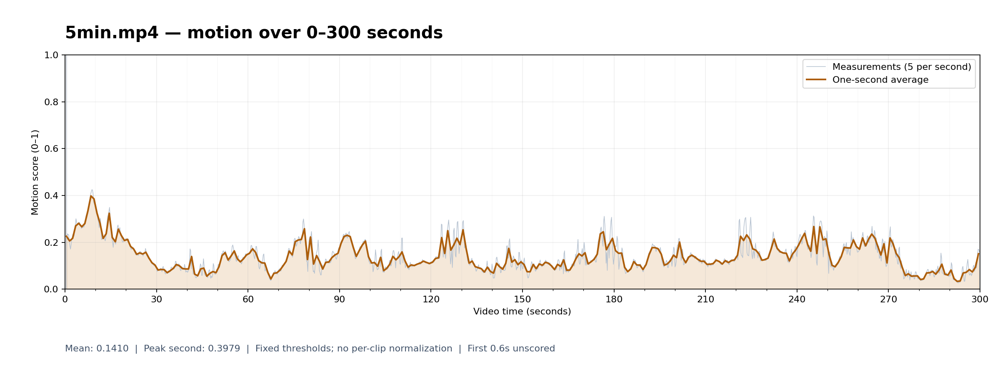

# Construction video motion graph

This experiment turns silent video from cameras mounted on construction vehicles and tools into a motion score over time. Its purpose is to help viewers find active periods in long recordings, using a lightweight mathematical calculation on CPU.

The first implementation uses Python, NumPy, and OpenCV. It requires no trained model or GPU. The score measures filtered visual change; camera movement, attachment movement, and moving shadows can all contribute.

## View the five-minute experiment



- **[Open the PNG plot](results/5min-motion.png)** to view the graph directly on GitHub.
- **[Open the HTML file](results/5min-motion.html)**, download the raw file, and open it in a browser. It contains the same Matplotlib plot as an embedded SVG and works offline. GitHub displays HTML source rather than running it as a webpage.
- **[Source recording](5min.mp4)** used for the experiment.

The horizontal axis covers **0–300 seconds**. Orange is the average score for each second; the faint gray line shows the underlying measurements, sampled five times per second. These are the actual results, without five-second aggregation or per-video min/max normalization.

The source recording lasts approximately 305 seconds; this plot shows the requested first 300 seconds.

| Measurement, first 300 seconds | Result |
| --- | ---: |
| Average motion score | 0.140984 |
| Highest one-second average | 0.397896 |
| Interval with the highest one-second average | 8–9 seconds |
| Highest individual comparison score | 0.424440 |
| Valid frame comparisons | 1,497 |

## How the calculation works

Every measurement uses the same configuration:

1. Resize the frame to **320 pixels wide**, preserving its aspect ratio; smaller inputs are not enlarged.
2. Convert to grayscale and apply a **5 × 5 Gaussian blur** to reduce fine image noise.
3. Sample at **5 frames per second** and compare frames **0.6 seconds apart**.
4. Subtract the median signed brightness difference to suppress approximately uniform additive exposure changes.
5. Keep pixels with an absolute corrected brightness difference **greater than 12 out of 255**.
6. Apply a **3 × 3 morphological opening** and discard connected changed regions smaller than **0.1% of the analyzed image**.
7. Calculate the retained changed-area fraction, `A`.
8. Apply a fixed **1% image-area noise allowance**:

```python
score = max(0.0, min(1.0, (A - 0.01) / 0.99))
```

A one-second result is the mean of valid comparisons in that second. A whole-clip result is the mean of all valid comparisons, so partial seconds receive the appropriate weight.

### What the values mean

- **0** means no change survived the filters and fixed noise allowance. It does not mean the original frames are identical.
- Values between **0 and 1** represent increasing image area with qualifying visual changes.
- **1** is the upper bound of the fixed scale, not the largest value observed in a particular recording.

For example, a score near 0.25 corresponds to approximately a quarter of the analyzed image showing qualifying change, adjusted for the noise allowance. It is not a productivity percentage, a movement probability, or a physical speed measurement.

Parameters remain fixed across recordings. There is no adjustment based on each video's minimum, maximum, or average. Changing the parameters changes the measurement definition and should produce a new algorithm/configuration version.

## Initial 15-second checks

All three initial recordings are 640 × 480 at 25 fps. They used the same settings as the five-minute experiment.

| Recording | Whole-clip score | Highest one-second average | Mean retained changed area before the final noise allowance |
| --- | ---: | ---: | ---: |
| [digging-1.mp4](digging-1.mp4) | 0.245730 | 0.408996 | 25.327293% |
| [standing-1.mp4](standing-1.mp4) | 0.000000 | 0.000000 | 0.000000% |
| [standing-2.mp4](standing-2.mp4) | 0.000000 | 0.000000 | 0.019495% |

Both standing clips contain image differences. Filtering removes the small changes in `standing-1`; `standing-2` retains a tiny changed area, but every comparison stays below the fixed 1% allowance. Their zero scores are therefore intentional consequences of the filtering.

These clips are development examples, not an independent evaluation set.

## Different recording lengths and chunk boundaries

The per-comparison calculation is independent of the total recording length. A 15-second input and a 60-second input use the same time interval and thresholds.

For the website timeline, retain **one score per second** rather than replacing each arbitrarily sized upload with one number. A whole-upload average can dilute brief activity differently depending on upload length.

Each comparison needs 0.6 seconds of preceding footage:

- Without preceding context, the initial **0.6 seconds is unmeasured**, not zero.
- In these experiments, the first second contains two valid comparisons; later complete seconds contain five.
- For continuous chunk processing, prepend 0.6 seconds from the previous recording, exclude that context from the output period, and preserve the shared 5 Hz sampling grid.
- Do not compare across a genuine recording gap. Mark unavailable coverage explicitly.

A separate engineering check compared a constructed 60-second recording against four 15-second jobs with preceding context. Their per-comparison scores matched exactly. The fixture repeated existing footage and is not additional real-world validation.

## Limitations to test next

This baseline deliberately trades sensitivity to tiny changes for a quieter graph. Small or slow genuine movement can be suppressed along with noise.

- Strong engine vibration or camera shake may produce false activity.
- Large areas of wind-blown vegetation, changing shadows, rain, or dust may contribute.
- Low-contrast movement can be missed; grayscale also loses color-only differences.
- Median brightness correction can suppress broad, approximately uniform changes.
- Equal physical actions can score differently under different viewpoints and textures.
- Identical images alone cannot distinguish a frozen recording from a perfectly still scene.
- The calculation does not identify digging, loading, idling, or productive work.

Evaluate more parked-but-vibrating, windy, travelling, nighttime, and slow-action footage before adding stabilization, region masks, or optical flow. Add complexity in response to measured failures.

## Files and implementation status

```text
contech-motion/
├── README.md
├── 5min.mp4
├── digging-1.mp4
├── standing-1.mp4
├── standing-2.mp4
└── results/
    ├── 5min-motion.png
    └── 5min-motion.html
```

The files currently committed here are input recordings and plot exports. The Python analysis and plotting code was run during the experiment; it is not yet packaged as a runnable application in this folder. There is no deployed Lambda service in this repository.

The analysis used NumPy and OpenCV; plot generation used Matplotlib. Processing the approximately five-minute source took **6.76 seconds in the development environment**, including decoding. This excludes download time and is not an AWS Lambda benchmark or cost estimate.
